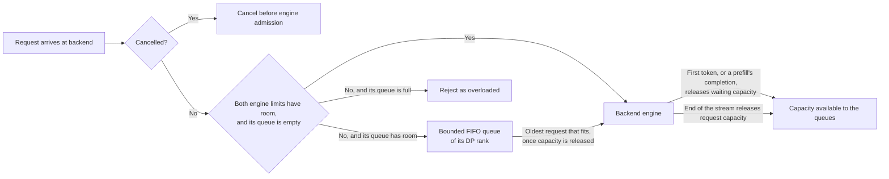

NVIDIA Dynamo admission control aims to sustain useful work as offered load grows. The current
implementation places an admission gate before each backend engine, with two engine limits and bounded
first-in, first-out (FIFO) queues, applied per data-parallel (DP) rank.

For deployment instructions, see [Admission Control on Kubernetes](../../../../kubernetes/fault-tolerance/admission-control.md).

## Goal

Goodput is the rate of requests served within their service-level objective (SLO). When offered load
exceeds the engine's capacity to meet that objective, accepting more work can increase contention,
lengthen waits, and reduce goodput even while the engine remains busy.

Admission control keeps excess work outside the engine and admits work as capacity becomes available.
The goal is to sustain goodput near the engine's SLO-feasible capacity as demand continues to rise.


This graph illustrates the goal; it is not benchmark data or a guarantee for every workload.

## Backend

The backend gate is local overload protection: it bounds the requests a worker admits to its engine
and the requests waiting outside it, admits them in FIFO order, and releases capacity reliably however
a request ends. It does not enforce latency targets or preempt engine work. SLO enforcement,
Controlled Delay, predictive admission, and session scheduling belong to router-level work.

### Gate Placement and Request Flow

Each backend worker process has one admission gate, applied where its backend receives typed requests
and hands them to its engine rather than in the request plane. The request planes (TCP and NATS) only
route requests, responses, cancellation, and errors to registered endpoints; the backend admits each
request before its engine sees it:

- A native backend, a Rust or sidecar worker serving `PreprocessedRequest` or an in-process token
  engine such as the mocker, admits through a typed wrapper on its network path.
- A Python backend admits in its Rust binding, for an endpoint that is a model backend: one whose role
  `register_model` has recorded.

All backend endpoints of a process share the one gate, with its limits and queues. Backend workers have
independent gates, including separate prefill and decode workers in a disaggregated deployment.

Nothing else passes through the gate: control, indexer, and other ordinary endpoints; Python endpoints
without a backend role; bidirectional endpoints; a worker's local health-check canaries, which call its
engine directly; and native media and in-process text engines, which serve no `PreprocessedRequest`.

`register_model` records a Python backend's role before it builds and publishes the model card. An
endpoint that is already serving admits its requests from then on; until then, and on an endpoint that
never registers, requests are served without this gate. Until the card reports the engine's capacity
and ranks, the gate admits that backend's requests under the fallback limits, as unspecified-rank work
(see [Configuration](#configuration) and [DP Ranks](#dp-ranks)).



### Engine Limits and Permit Lifetimes

The gate tracks two kinds of engine capacity for each admitted request, one per limit:

| Limit | Bounds | Held from | Released at |
|---|---|---|---|
| Engine request limit | Admitted requests that have not finished | Admission | The end of the response stream, or cleanup |
| Engine request waiting limit | Admitted requests still waiting for their engine's output | Admission | The response that ends the wait (see [Waiting Release](#waiting-release)), or cleanup |

A request enters the engine only when both limits have room, and the gate reserves both kinds of
capacity together. Requests still waiting are always a subset of the unfinished requests, so
`engine_request_waiting_count <= engine_request_count`.

Obtaining the engine's stream object is not a response. If a request fails during setup, its stream
ends or fails before the response that ends its wait, or it is cancelled or dropped, the gate releases
whatever capacity it still holds, exactly once. A request cancelled or dropped after its wait ended
releases only its request capacity, because its waiting capacity is already released. Each release
makes queued work runnable when both limits have room.

### Waiting Release

A request's wait ends at the response its worker's role names:

| Worker role | Its wait ends at |
|---|---|
| Decode and aggregated | The first response carrying a generated token |
| Prefill | Its completion response, which need not carry a token; a token alone does not end it |
| Encode | The first response carrying a generated token; an encoder that generates none waits until its stream ends |

The backend classifies the responses it hands the gate from its own response contract; the gate never
parses a payload, and items reach the caller unchanged. A native backend reads its engine output: a
non-empty `token_ids` is a generated token, and the `finish_reason` that marks its one terminal output
is its completion. A Python backend's binding reads the response object while it parses it for the
request plane anyway, under the GIL it already holds, so classification takes no extra pass or GIL
acquisition, and the handler's generator is still advanced only when the next response is wanted. It
classifies a request's responses only up to the first one that ends the wait and is successfully
encoded and placed in the response stream, because the gate reads no later classification; a response
that fails to encode or send leaves the next one classified. A request that arrives while its Python
endpoint is not a model backend, and every request on a bidirectional endpoint, is neither admitted nor
classified. The gate still observes the classified responses in stream order and releases waiting
capacity at the one that ends the wait, however far ahead of it a push handler has sent. A non-empty
`token_ids` is a generated token, and a non-null `finish_reason` marks a completion. So does the vLLM
prefill result, which names no finish reason but always reports its `completion_usage` beside its
`disaggregated_params` handoff. Usage alone completes nothing, because some engines report it early.

Metadata and control responses, such as a disaggregation bootstrap announcement or a cache report,
annotation-only responses, and errors are interim on every worker and end no wait. Beyond that, a decode, aggregated,
or encode worker's wait ends only at a generated token: a completion without one does not end it, nor
does a response that carries no `token_ids` at all, such as a text-mode OpenAI chunk, an embedding, or
media. A prefill worker's wait ends only at its completion response, with or without a token. A request
whose stream ends, fails, or is dropped first releases both kinds of capacity together, so for such
streams both permit lifetimes coincide.

Prefill completion depends on the backend:

| Prefill worker | Its response stream | Its wait ends |
|---|---|---|
| vLLM | One result after the engine's prefill output: its token if the engine produced one, KV-transfer parameters, and usage, with no finish reason | At that result |
| SGLang | A bootstrap announcement before prefill runs, then possibly a cache report, then the end of the stream | At the end of the stream, together with its request capacity |
| TensorRT-LLM | One terminal result with a finish reason | At that result |
| Native: Rust and sidecar workers, the mocker | Possibly handoff announcements or a token, then a terminal output with a finish reason | At that terminal output |

The waiting state therefore runs from admission to the first generated token, or to a prefill's
completion. It does not promise a KV-transfer boundary:

- The vLLM decode handler in token mode forwards only completion outputs that carry tokens or a finish
  or stop reason, so an output with neither never reaches the gate. An error it yields before it calls
  its engine carries no token, so that request waits until its stream ends.
- In vLLM 0.30, a decode request whose KV cache arrives from a remote prefill waits in
  `WAITING_FOR_REMOTE_KVS` until its connector reports the transfer received, or failed and then
  recomputed locally, so its first token follows that point. The gate does not observe or guarantee
  this.
- A prefill's completion does not mean the decode worker has its KV cache. On the inspected vLLM path
  with the NIXL connector, where the decode worker pulls the KV cache, vLLM's completion result carries
  the KV-transfer parameters that the decode worker uses later, so it precedes the transfer; other
  connectors, such as push-based Mooncake or cache-mediated LMCache, can transfer earlier. SGLang hands
  off its bootstrap details before its prefill runs and completes only at the end of its stream, and a
  native worker may announce its handoff before its terminal output. The gate observes none of these
  transfers.

### DP Ranks

A worker process can serve several DP ranks. Its model card reports them as global rank IDs: start rank
`A` and count `N` serve ranks `A` through `A + N - 1`, which map to local slots `0` through `N - 1`.
Each rank has its own two engine limits and its own bounded FIFO queue, all set by the same per-rank
values. The process-wide limits aggregate that same capacity without adding any: for per-rank request,
waiting, and queue limits `R`, `W`, and `Q`, the process allows `N * R`, `N * W`, and `N * Q`.

The gate reads a request's DP rank from the request itself: the `routing.dp_rank` field of its body,
which routing sets for each dispatch, including the separate prefill and decode dispatches of a
disaggregated request, and which the backend also reads to choose the engine rank that serves it. A
native worker reads the field from the decoded request. A Python worker records it while decoding the
body into the object its handler receives, so admission reads a cached value and never inspects that
object or takes the GIL for it. Requests on any other endpoint are neither admitted nor accounted
under a rank, whatever their body holds. The gate classifies each request once, on arrival:

| Request rank | Engine admission and accounting | Queueing and accounting |
|---|---|---|
| A rank the worker serves | Needs room under both process-wide engine limits and both limits of its rank. Counts at both scopes. | Uses its rank's FIFO. Needs room under its rank's queue limit and the process-wide queue limit. Counts at both scopes. |
| Unspecified | Needs room under both process-wide engine limits. Counts only at process scope. | Uses the FIFO for unspecified-rank requests, which draws on the same process-wide queue limit as every rank's queue. |

A request is unspecified when its body names no rank, when the worker has not reported its ranks yet, or
when the named rank is outside the reported range. A body names no rank when `routing.dp_rank` is
missing or null, or, in a Python worker, holds anything but an unsigned 32-bit integer (a boolean does
not count). A supplied rank that arrives before the worker reports its ranks, or that is outside the
reported range, logs a warning naming the rank (and the range, when known); a request without a rank
logs nothing. The gate never rejects a request for its rank, never attributes an unspecified request to
rank zero, and never rewrites the request's own routing fields. Before the worker reports its ranks, the
gate sizes the process-wide limits for one rank.

A request keeps the rank it was classified under for its whole stay, however the reported ranks change
later, so every release returns exactly what the request took. Unspecified and ranked requests draw on
the same process-wide capacity, so each can hold the other back. The gate cannot attribute an
unspecified request to the rank its engine eventually selects: per-rank limits cap requests with a known
rank, not the engine's actual occupancy of each rank while unspecified requests are present. The
process-wide limits still cap every request.

### Queue

A request that cannot enter immediately waits in its FIFO queue, holding no engine capacity. A new
arrival is admitted directly only when its own queue is empty, so it never bypasses an older request
in that queue. When capacity is released, the oldest request at the head of any queue that now has all
the capacity it needs is admitted next, so a rank at its own limit never blocks another queue and no
eligible queue starves. When its queue is full, the request is rejected before it reaches the engine. A
queue limit of `0` disables queueing. Queue residence has no age limit: a request leaves the queue only
by admission or cancellation.

Adding a request to its queue and unlinking one, including a cancelled request from the middle of a
queue, take constant time regardless of queue length. The queues are doubly linked lists threaded
through one pool of slots, sized for the process-wide queue limit when the gate starts or its queue
limit grows, and each queued request keeps a handle to its own slot. A removed slot is reused at once,
and a generation number on each slot keeps a stale handle from ever reaching a newer request. Choosing
the next request to admit scans no queues: the gate indexes the head of every queue whose rank has room
under its own limits by arrival, and checks the process-wide limits separately, since they are the same
for every queue. A transition updates the index only for the queues it changes, in O(log H) time per
changed queue head for H indexed heads; only a change of limits or ranks rebuilds the whole index.

### Cancellation

The gate acts on cancellation visible in the request's backend context and on a dropped queued request:

| When the gate observes cancellation | Gate behavior | Accounting |
|---|---|---|
| On arrival, before queueing or direct admission | The request neither queues nor enters the engine. | `cancellation_total` once; no admission or rejection. |
| While queued, including a dropped waiting request | The request leaves its queue at once, without reaching the head or waiting for capacity. It never enters the engine. | Its queue place is released at every scope at once; `cancellation_total` once. |
| At the dequeue decision | The gate discards the request and continues with the next. | Queue place released; `cancellation_total` once. |
| After the dequeue decision | Once the request is handed to the engine, the normal downstream cancellation applies. | An engine handoff stays an admission, and its capacity is released at cleanup. Capacity offered but never taken is refunded, and the request counts as a cancellation. |

One lock serializes queue removal and dequeue, so exactly one of them takes a request off its queue,
and no count is ever released twice. If capacity was already offered to a queued request whose caller
then leaves, the request refuses the offer, the capacity goes to the next request, and the request is
counted as a cancellation, not an admission.

The gate can act only on cancellation that reaches it. When a client disconnects, the frontend cancels
the request and forwards that cancellation to the worker while it still awaits the worker's response
prologue, which the worker sends only after admission. Process-level tests show this for text requests
on both the TCP and NATS request planes over the TCP response path: a request whose caller disconnects
while it is queued leaves the queue as a cancellation before it reaches the engine. The frontend defers
cancellation until the prologue for a request that carries a first-response guard, which holds decoded
multimodal source data until the worker answers. Such a request stays queued after its caller
disconnects until it is admitted, and its cancellation then follows the normal downstream path.

### Overload Rejection

A request rejected for capacity fails with a worker-overloaded error. Its worker-overload
classification, its stable reason `capacity.worker_overloaded`, survives the transport and the
frontend's error handling, although its legacy error type changes on the wire. The router recognizes
that classification anywhere in the error chain, even inside the connection error the transport wraps
it in. It marks the worker overloaded for a bounded
lease instead of reporting it down, so the healthy worker stays discoverable and serves again as
capacity returns. Real connection and worker failures still report the worker down.

When the frontend finally refuses a request for overload, it answers with its configured overload status:
HTTP 529 by default, set by `DYN_HTTP_OVERLOAD_STATUS_CODE`. A cancellation before admission is a
cancellation, not an overload, and engine errors keep their own classification.

### Configuration

Set these on the backend worker process. Each is a per-DP-rank limit, read when the gate is created;
restart the worker process to change an explicit value.

| Setting | Environment variable | Also configured by | Automatic value | Accepted values |
|---|---|---|---|---|
| Engine request limit | `DYN_BACKEND_ADMISSION_ENGINE_REQUEST_LIMIT` | `--engine-request-limit`; legacy `DYN_ENGINE_REQUEST_LIMIT` | Reported `max_num_seqs`, or `10000` until reported | Positive integer |
| Engine request waiting limit | `DYN_BACKEND_ADMISSION_ENGINE_REQUEST_WAITING_LIMIT` | Former name `DYN_BACKEND_ADMISSION_ENGINE_WAIT_LIMIT` | Reported `max_num_seqs`, or `10000` until reported | Positive integer |
| Request queue limit | `DYN_BACKEND_ADMISSION_REQUEST_QUEUE_LIMIT` | Legacy `DYN_DYNAMO_REQUEST_QUEUE_LIMIT` | Twice the reported `max_num_seqs`, or `20000` until reported | Non-negative integer; `0` disables queueing |

The CLI flag and aliases configure the same settings; they are not separate controls. An explicit
`--engine-request-limit` takes precedence over both engine request limit variables: the worker exports
it to the canonical variable as it validates its configuration, before the runtime starts. Each
canonical variable takes precedence over its alias. The gate skips an invalid environment value, logs a
warning, and uses the next source in that order; a valid canonical value is used without reading its
alias. A worker that accepts `--engine-request-limit` instead rejects a flag value that is not a
positive integer at startup.

Each setting resolves on its own. An explicit value always wins and stays per rank. Otherwise the
setting follows `max_num_seqs` as the engine reports it in its model card, `S`, with `S = 10000` until
the report arrives: `S` for each engine limit and `2 * S` for the queue. The process-wide limits multiply
each per-rank limit by the reported rank count, once. Overriding one setting does not change another's
automatic value; in particular, the automatic queue limit follows `S`, not an overridden engine limit.
After `max_num_seqs` is reported, a queue deeper than `2 * S` per rank needs an explicit value.

Capacity and rank reports update the automatic limits and the rank count whenever they arrive or
change. They never replace an explicit value, including a queue limit of `0`, and they never reset live
occupancy or invalidate queued requests or admitted ones. A lower limit evicts nothing: it holds further
admission and queue entry back until occupancy falls below it.

The worker logs the effective limits, each with its source and scope, in its `Backend admission gate
created` message, and again in `Backend admission limits updated from the reported engine capacity`
when a report changes them. Once `max_num_seqs` is known, the worker warns about each nonzero limit
that exceeds it by more than 10 times, per rank and process-wide; it evaluates this when capacity first
arrives or changes, never per request.

The waiting limit and its gauge were renamed. Update deployments and dashboards:

| Before | Now |
|---|---|
| `DYN_BACKEND_ADMISSION_ENGINE_WAIT_LIMIT` | `DYN_BACKEND_ADMISSION_ENGINE_REQUEST_WAITING_LIMIT` (the former name still works as an alias) |
| `dynamo_backend_admission_engine_wait_count` | `dynamo_backend_admission_engine_request_waiting_count` |

> [!NOTE]
> Capacity-derived defaults are starting settings. Tune the limits for your workload with the
> procedure in [Sizing and Tuning](#sizing-and-tuning).

### TCP Worker Pool

A TCP request holds its worker-pool permit while it waits at the gate, so the TCP worker pool can keep
the configured admission queue from filling. For a worker serving one rank, every queue place is
reachable only when `DYN_TCP_WORKER_POOL_SIZE` is at least `engine_request_limit + request_queue_limit`.
For `N` ranks sharing the process's pool, use `N * (R + Q)`, which already covers unspecified-rank
traffic within the process-wide capacity. Other users of the same pool may need more headroom. NATS
requests do not pass through this pool. The gate does not size, check, or warn about the pool.

### Metrics

A backend worker exposes these metrics at its metrics endpoint from the moment its backend path admits
through the gate, before its first request: when it builds its native admission wrapper, or when
`register_model` records a Python endpoint's role. A process with no backend path through the gate,
such as a native media or in-process text engine, does not expose them. Each metric has a `dp_rank`
label naming the rank the gate classified and accounted the request under, whether it was then
admitted, queued, rejected, or cancelled: a served global rank such as `dp_rank="4"`, or
`dp_rank="unspecified"`.

| Metric | Type | Meaning |
|---|---|---|
| `dynamo_backend_admission_engine_request_count` | Gauge | Admitted requests that have not finished. |
| `dynamo_backend_admission_engine_request_waiting_count` | Gauge | Admitted requests whose wait has not ended: no first generated token yet, or, on a prefill worker, no completion yet. |
| `dynamo_backend_admission_request_queue_count` | Gauge | Requests waiting in a gate queue. A queued request removed by cancellation leaves the count at once. |
| `dynamo_backend_admission_request_receive_total` | Counter | Requests entering the gate, each counted once. |
| `dynamo_backend_admission_request_admit_total` | Counter | Requests handed to the engine, labeled `source="direct"` or `source="queue"`. |
| `dynamo_backend_admission_rejection_total` | Counter | Requests rejected for capacity. No reason label. |
| `dynamo_backend_admission_cancellation_total` | Counter | Requests cancelled before engine handoff, each counted once: on arrival, while queued, at the dequeue decision, or by refusing offered capacity. |

`unspecified` has its series from the moment the metrics are exposed, and each served rank from the
moment the worker reports its ranks, all at zero before their first request. Each request contributes to one series of each gauge, so the sum of a gauge's series, `unspecified` included, is the process total;
the gate publishes no separate aggregate series. Dashboards that read the previous unlabeled series
should sum over `dp_rank` for process totals. The limits are configuration, not exported as metrics.

The admission counter advances at the engine handoff, not when a request joins a queue or is offered
capacity, and an engine failure or cancellation after the handoff does not undo it. Once every request
has settled, with none still queued or in handoff, each `dp_rank` series satisfies:

```text
receive = admit{source="direct"} + admit{source="queue"} + rejection + cancellation
```

Engine streams may still be running when it holds. Separately scraped series are not an atomic
snapshot, so do not expect the identity to hold exactly on a live scrape with requests still pending.

### Sizing and Tuning

Measure each rank at the highest offered load that still meets the deployment's SLA, with the gate
open and the engine busy:

- `C`: the sustainable request rate.
- `W`: the mean time requests spend waiting, until their first generated token or, on a prefill
  worker, their completion: the average `engine_request_waiting_count` divided by the rate of
  `request_admit_total`, over the same steady-state interval and the same `dp_rank`.
- `S`: the rank's reported `max_num_seqs`.

For a workload-specific override, start with `ceil(C * W)` as the engine request waiting limit and
`S + waiting limit` as the engine request limit, within the engine's KV budget. These starting points do
not change the automatic values. Size the queue from the sustainable drain rate and the time clients can
still wait, allowing for engine time and every other serving hop. Validate each setting under load: the
gate does not enforce client deadlines.

`W` is a Little's-law estimate. It is a mean, not a median or a percentile, and it includes waits that
end without that response, such as cancellations and failures, so it is not a successful-request Time
To First Token (TTFT). Measure it over a steady workload with matching occupancy and rate populations; it
does not hold instant by instant during a burst.

Read the signals, then confirm under load before changing a limit:

- A growing gate queue while engine capacity is free suggests the engine limits admit too little.
- A growing engine wait with an empty gate queue suggests they admit too much.
- Rejections below the sustainable load call for checking both the queue limit and the engine limits.

Re-measure after changing the image, the KV-transfer path, the KV layout, or the prompt mix.

For aggregated workers, use the queue as the burst backstop, and size the engine request limit for KV
pressure where it binds first. For disaggregated serving, tune decode admission against its observed
first-token boundary, and size prefill against its batch capacity; when a prefill's completion is the
end of its stream, as for SGLang, its two permit lifetimes coincide. Router admission before prefill
can avoid spending prefill work on requests decode later refuses, but that policy is outside the backend
gate.

## Router

Router admission control is planned for future work.
